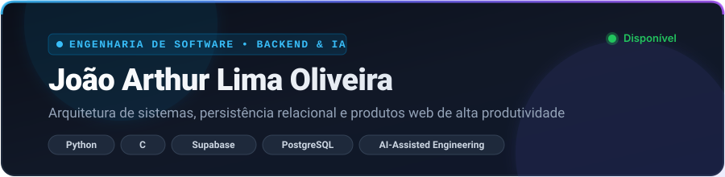

  <!-- Banner moderno em SVG de alta resolução auto-hospedado -->
  

    

  <!-- Texto digitado dinamicamente -->
  

  

    
    
    
  

---

### 👨‍💻 Sobre Mim & Filosofia de Trabalho

Sou estudante de **Engenharia de Software** com foco em **Backend, modelagem relacional de dados e desenvolvimento assistido por Inteligência Artificial (AI-Assisted Engineering)**.

Acredito que a engenharia moderna não se resume a digitar código do zero, mas em **saber arquitetar soluções, garantir regras de negócio sólidas e dominar ferramentas de ponta** para construir produtos reais de ponta a ponta com máxima produtividade.

- ⚙️ **Base Sólida em Backend & Computação:** Compreensão de algoritmos, ponteiros e gestão de memória em **C**, aliada à flexibilidade, automação e lógica de scripts em **Python**.
- 🗄️ **Modelagem de Dados & BaaS:** Experiência prática na estruturação de bancos relacionais com **PostgreSQL** e **Supabase** (Row Level Security, Autenticação, Triggers e Queries).
- 🤖 **Engenharia Assistida por IA (AI-Driven Development):** Utilizo agentes avançados de IA para gerar, prototipar e refinar interfaces de front-end (Next.js, TypeScript e React), enquanto lidero ativamente a especificação técnica, validação de regras, integridade da infraestrutura e experiência do produto.

---

### 🛠️ Tecnologias & Nível de Domínio

#### 🔥 Core Stack — Domínio Prático & Backend
*Tecnologias que estudo, codifico e utilizo para lógica de negócio, infraestrutura e persistência de dados:*

  

 

| Área | Tecnologias | Atuação |
| :--- | :--- | :--- |
| **Linguagens** | Python, C | Algoritmos, scripts, lógica de negócio e manipulação de memória |
| **Banco de Dados & BaaS** | Supabase, PostgreSQL | Modelagem relacional, RLS (segurança por linha), Auth e Storage |
| **Infraestrutura & DevOps** | Git, GitHub, Vercel | Versionamento, automação de deploys e governança de código |

 

#### ⚡ AI-Assisted Stack — Interfaces & Prototipagem Acelerada
*Tecnologias que orquestro com suporte de agentes de Inteligência Artificial para entrega de interfaces web completas:*

  

 

| Camada | Ferramentas | Como aplico |
| :--- | :--- | :--- |
| **Full Stack / Front-End** | Next.js 15, React 19, TypeScript, Tailwind CSS | Direcionamento via engenharia de prompts, revisão de código gerado e integração com APIs |
| **Metodologia** | AI-Assisted Engineering & Prompt Design | Concepção arquitetural rápida e prototipagem iterativa de produtos digitais |

---

### 🌟 Projeto em Destaque

| 🎯 **Focalizee — Gestão Inteligente de Estudos e Produtividade** |
| :--- |
| Aplicação web completa desenvolvida com arquitetura moderna para organização acadêmica, ciclos Pomodoro e métricas de desempenho. |
| **Divisão de Responsabilidades:** • **Backend & Dados:** Modelagem relacional, tabelas, RLS e autenticação no **Supabase** (PostgreSQL). • **Interface Web:** Prototipada e acelerada via **desenvolvimento assistido por IA** com **Next.js 15**, **React 19** e **Tailwind CSS**. • **Infraestrutura:** Deploy contínuo e monitoramento na **Vercel**. |
| [🔗 Explorar Código no GitHub](https://github.com/joaoarthur1705/Focalizee) • [🚀 Testar Aplicação Online](https://focalizee-oficial-360du9o6k-focalizee.vercel.app) |

---

### 📊 Métricas & Consistência no GitHub

  
  

  

---

### 📫 Contato & Conexões Profissionais

  Estou sempre aberto a oportunidades de estágio, projetos colaborativos e conversas sobre engenharia de software e inteligência artificial!
    
  
  &nbsp;
  

  Construído com foco em arquitetura limpa, engenharia assistida por inteligência artificial e alta produtividade.

